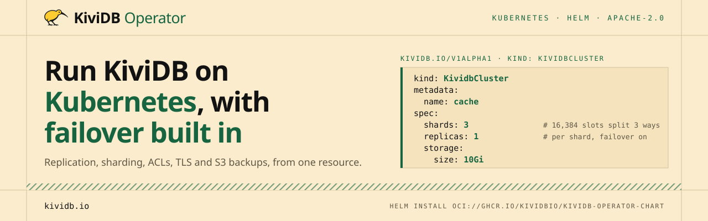
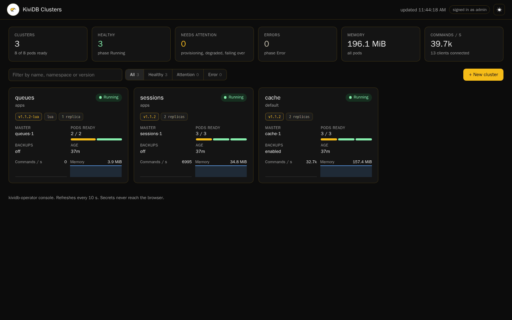

<p align="center">
  <a href="https://kividb.io"></a>
</p>

<p align="center">
  <a href="https://artifacthub.io/packages/search?repo=kividb-operator"></a>
  <a href="https://github.com/kividbio/kividb-operator/releases/latest"></a>
  <a href="https://github.com/kividbio/kividb-operator/actions/workflows/release.yaml"></a>
  <a href="LICENSE"></a>
  <a href="https://discord.com/invite/ZcMxFeSAPA"></a>
</p>

The **KiviDB Operator** runs [KiviDB](https://github.com/kividbio/kividb), the
Redis-compatible in-memory database, on Kubernetes. You describe a cluster in
one `KividbCluster` resource: a master with replicas, or a sharded cluster.
The operator keeps it running, fails over when a master dies, and takes
backups to S3.

## Install

With Helm 3.9+ on Kubernetes 1.27+:

```bash
helm install kividb-operator oci://ghcr.io/kividbio/kividb-operator-chart \
  --version 0.7.1 -n kividb-operator-system --create-namespace
```

This installs the CRDs, the operator and its web dashboard. To install
without Helm (`kubectl apply -k`), and to upgrade or uninstall, see
[docs/INSTALL.md](docs/INSTALL.md). On upgrades, apply the new CRDs first:
Helm doesn't update them.

## Create a cluster

```yaml
# kividb.yaml
apiVersion: kividb.io/v1alpha1
kind: KividbCluster
metadata:
  name: kividb-minimal
spec:
  storage:
    size: 5Gi
```

```bash
kubectl apply -f kividb.yaml
kubectl get kividbcluster -w        # or: kubectl get kdb
kubectl port-forward svc/kividb-minimal-master 6380:6380
redis-cli -p 6380 ping
```

That's a master and two replicas (the default), with automatic failover. It
has no password: fine for trying it out, not for anything reachable from
outside the cluster. Add `aclConfigRef` for users and passwords
([docs/CONFIGURATION.md](docs/CONFIGURATION.md)).

For a sharded cluster, add `shards`. Each shard is a master with `replicas`
replicas, and the 16,384 hash slots are spread over the shards:

```yaml
spec:
  shards: 3
  replicas: 1
  storage:
    size: 10Gi
```

[`config/samples/`](config/samples/) has a full example: ACL users, TLS,
S3 backups, a LoadBalancer Service and monitoring.

## What it does

- **Failover.** When a master is unhealthy, the most caught-up replica is
  promoted, and the old master is fenced first so its last writes aren't
  lost. Planned switchovers hold writes while they hand over.
- **Sharding.** `spec.shards` runs KiviDB's cluster mode, with failover per
  shard. You can change the shard count on a running cluster: slots move
  to the new shards, or off the ones being removed.
- **Services.** A master Service and a replicas Service, each `ClusterIP`,
  `NodePort` or `LoadBalancer`.
- **Security.** ACL users and `requirepass` from Kubernetes Secrets, and TLS
  from a certificate Secret.
- **Backups.** Scheduled snapshots to any S3-compatible store (AWS S3,
  MinIO, R2, B2, Ceph), with retention, and a `KividbSnapshot` record of
  each run. Restoring is in [docs/BACKUP_RESTORE.md](docs/BACKUP_RESTORE.md).
- **Operations.** Rolling restarts with `KividbDbOps`, Prometheus metrics
  and an optional `ServiceMonitor`, and the usual scheduling controls
  (`resources`, `tolerations`, `nodeSelector`, `affinity`).

Each KiviDB pod runs a small agent beside the database. The operator talks
to that agent over HTTP, never to the database directly.
[docs/ARCHITECTURE.md](docs/ARCHITECTURE.md) shows how a failover and a backup
go, step by step.

## Custom resources

Configuration, ACLs and backup settings are separate resources, so one of each
can be shared by many clusters. A `KividbCluster` refers to them by name.

| Kind | Short name | What it is |
|---|---|---|
| `KividbCluster` | `kdb` | The cluster: topology, storage, Services, monitoring, failover |
| `KividbConfig` | `kdbc` | `kividb.conf` directives and TLS settings |
| `KividbAclConfig` | `kdbacl` | ACL users and `requirepass` |
| `KividbSnapshotConfig` | `kdbsc` | Backup schedule, S3 destination, retention |
| `KividbSnapshot` | `kdbs` | One backup run, created by the operator (read-only) |
| `KividbDbOps` | `kdbops` | A one-off operation on a cluster, such as a rolling restart |

Every field: [docs/CONFIGURATION.md](docs/CONFIGURATION.md).

## Web dashboard

<p align="center">
  
</p>

The Helm chart also installs a dashboard: each cluster's health, replication
lag, metrics, logs, a command console and backups. It can also scale, fail
over, take snapshots and create clusters. It never gets access to Secrets,
and is read-only until you give it credentials.

```bash
kubectl port-forward -n kividb-operator-system svc/kividb-operator-gui 8090:8090
# open http://localhost:8090
```

More screenshots and setup: [docs/GUI.md](docs/GUI.md).

## Documentation

| Doc | Covers |
|---|---|
| [INSTALL.md](docs/INSTALL.md) | Helm and kustomize install, upgrade, uninstall |
| [CONFIGURATION.md](docs/CONFIGURATION.md) | Every field of every resource, sharding |
| [BACKUP_RESTORE.md](docs/BACKUP_RESTORE.md) | S3 backups, on-demand backups, restoring |
| [ARCHITECTURE.md](docs/ARCHITECTURE.md) | Design, the agent, failover and backup sequences |
| [TROUBLESHOOTING.md](docs/TROUBLESHOOTING.md) | Symptom, cause, fix |
| [GUI.md](docs/GUI.md) | Running and deploying the dashboard |
| [ROADMAP.md](docs/ROADMAP.md) | What's shipped and what's next |
| [RELEASING.md](docs/RELEASING.md), [VERSIONING.md](docs/VERSIONING.md) | Releases, and fetching the docs of a given version |
| [CONTRIBUTING.md](CONTRIBUTING.md) | Local development and the PR checklist |

## Status

The operator is at **0.7.1** ([CHANGELOG.md](CHANGELOG.md)). It runs KiviDB
**v1.2.1** when `spec.image` is unset. KiviDB 1.2.2 is out, with a fix for
servers that use search indexes; to run it, set
`spec.image: docker.io/kividb/kividb:v1.2.2`. Before upgrading the operator,
read the CHANGELOG's "Read before upgrading": an upgrade restarts every
cluster that leaves its images unset. The API is `kividb.io/v1alpha1` and
may still change.

## License

[Apache License 2.0](LICENSE).
