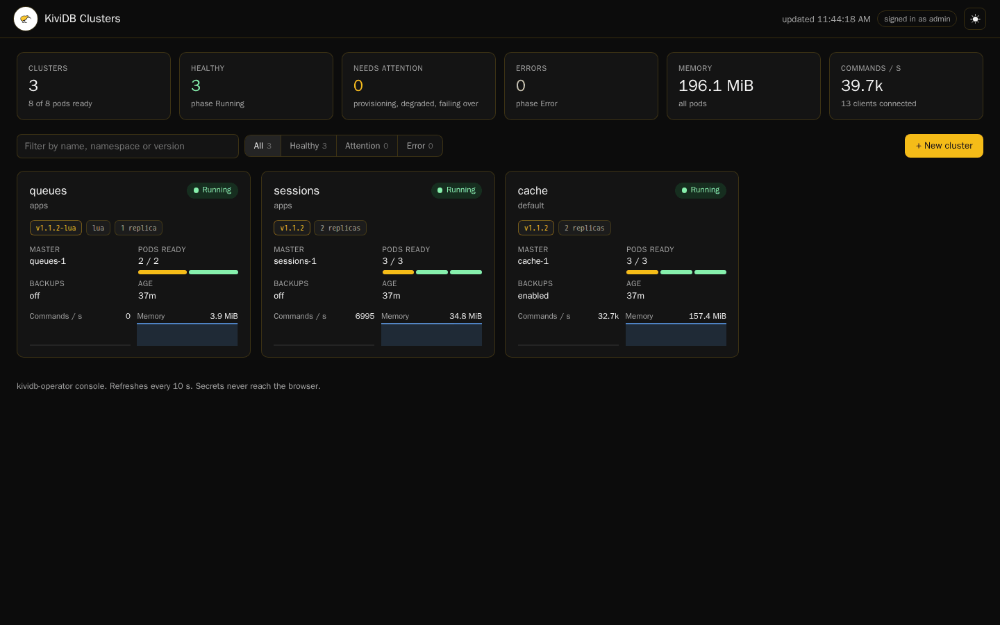
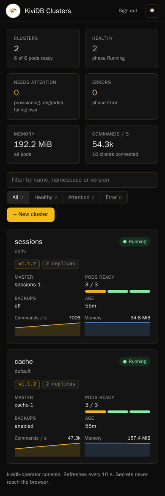
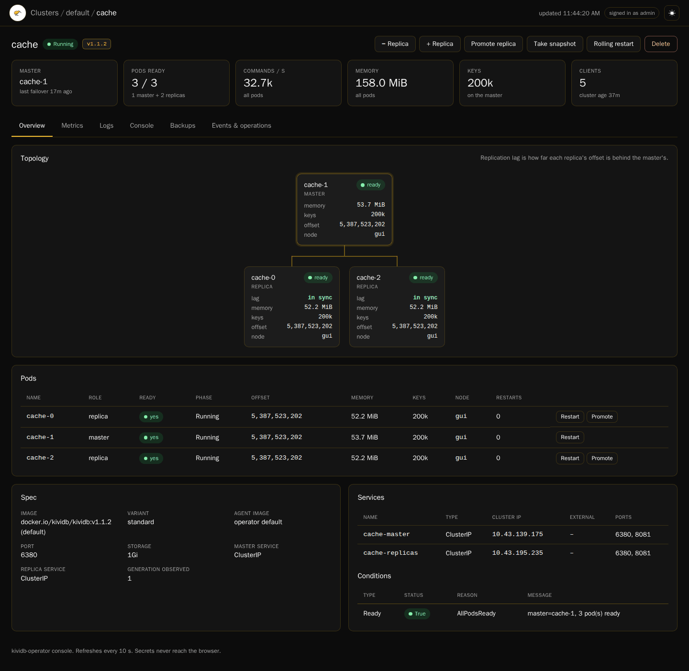
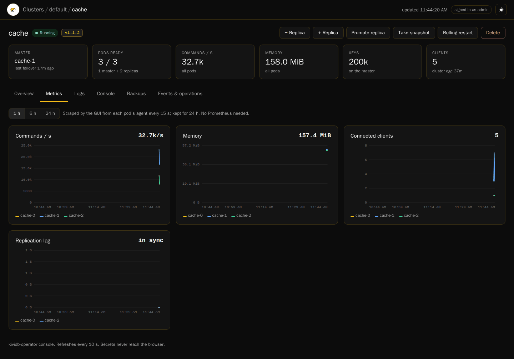
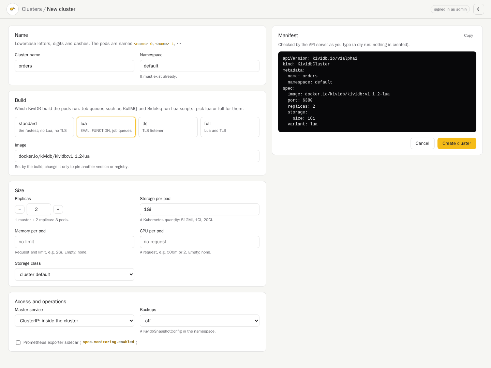

# kividb-operator GUI

<p align="center">
  
</p>

A management web dashboard for `KividbCluster` objects. It is a single
static Go binary (`cmd/gui`) with HTML/CSS/JS embedded via `embed.FS` —
no Node/npm build step.

The GUI never lists Secrets to the browser. ACL passwords and S3
credentials stay out of the UI. Auth credentials for the GUI itself come
from env (`GUI_AUTH_USERNAME` / `GUI_AUTH_PASSWORD`), typically via a
Kubernetes Secret keyRef in the chart — not by the GUI reading Secrets
through the API.

## What it shows

Light and dark themes (it follows the system until you pick one) and a
layout that works on a phone. Every page refreshes every 10 s.

<p align="center">
  
</p>

### Dashboard (`/`)

- **Summary tiles**: how many clusters, how many are healthy (`Running`),
  need attention (provisioning, degraded, failing over) or are in `Error`,
  and the memory, commands per second and connected clients of all their
  pods.
- **A card per cluster**: phase, engine version and build, replicas, master,
  a bar of its pods (ready, master), backups, age, and sparklines of the last
  hour's commands per second and memory.
- **Search and a health filter.**

The live figures come from the GUI's own scrapes (below), held in memory:
listing the dashboard is still one `List` of `KividbCluster`s.

### Cluster (`/clusters/{namespace}/{name}`)

<p align="center">
  
</p>

- **Actions**: add or remove a replica, promote a replica, take a snapshot,
  a rolling restart, delete. Each asks first, in a dialog; deleting asks for
  the cluster's name.
- **Overview**: the **topology** (the master and its replicas, with each
  one's readiness, memory, keys, replication offset and node, and how far
  each replica is behind the master), the pods (restart or promote one),
  the spec, the Services and the conditions.
- **Metrics**: commands per second, memory and clients per pod, and each
  replica's replication lag, over 1 h, 6 h or 24 h. Hover for every pod's
  value at that moment. The GUI scrapes each pod's agent (`/metrics`) every
  15 s and keeps 24 h, in memory by default or under `GUI_METRICS_DIR` when
  set (chart: `gui.metrics.persistence.enabled=true`, plus
  `gui.metrics.persistence.storageClass` on clusters without a default
  StorageClass). No Prometheus needed.
<p align="center">
  
</p>

- **Logs**: either container of any pod, the last 200 to 2000 lines, with
  follow mode, highlighting, and errors and warnings in colour.
- **Console**: runs a command on a pod through its agent, as the agent's
  user, and prints the reply as `redis-cli` does. Quotes keep words
  together; ↑ and ↓ go through the history. Commands that can lose data or
  change replication (`FLUSHALL`, `CONFIG`, `REPLICAOF`, …) ask first.
- **Backups**: the snapshot schedule and retention, the last success and
  error, and the snapshots.
- **Events & operations**: the cluster's Events, and its `KividbDbOps`.

**Promote** switches the master to the chosen pod: the GUI promotes it and
makes the current master its replica, and the operator then moves the
`kividb.io/role` label (and so the master Service) and re-points the other
replicas. Writes that reach the old master in the moment between those two
steps are not carried over.

### New cluster (`/new`)

<p align="center">
  
</p>

A form for a `KividbCluster`: name and namespace, the build (standard, lua,
tls or full), replicas, storage, memory and CPU per pod, storage class,
master Service type, backups (a `KividbSnapshotConfig` in the namespace)
and the Prometheus exporter. Picking a build sets the matching image as
well as `spec.variant`: the operator never derives one from the other.

Beside the form is the manifest, as the API server's dry run of it returns
it: the form is checked, and the server's defaults filled in, as you type,
before anything is created. **Copy** puts it on the clipboard for
`kubectl apply` or a Git repository. On a read-only GUI the form still
works and the manifest is shown, but nothing can be created.

Default engine image when `spec.image` is empty:
`docker.io/kividb/kividb:v1.1.2`.

### JSON API

| Method | Path | Notes |
|--------|------|--------|
| GET | `/api/session` | `writable` (auth is on), `user`, `watchNamespace` |
| GET | `/api/clusters` | Dashboard rows, with `stats` once scraped |
| POST | `/api/clusters` | Create a cluster from the form's JSON; `?dryRun=1` validates and returns the YAML without creating |
| GET | `/api/create-options?namespace=` | Snapshot configs, storage classes and builds for the form |
| GET | `/api/clusters/{ns}/{name}` | Detail payload |
| DELETE | `/api/clusters/{ns}/{name}` | Delete the cluster |
| GET | `/api/clusters/{ns}/{name}/live` | Per-pod agent status: role, offset, memory, keys |
| GET | `/api/clusters/{ns}/{name}/metrics?from=&to=` | 24 h series (unix ms) |
| GET | `/api/clusters/{ns}/{name}/dbops` | DbOps list |
| POST | `/api/clusters/{ns}/{name}/restart` | Create an InPlace restart DbOps |
| POST | `/api/clusters/{ns}/{name}/scale` | `{"replicas": n}` |
| POST | `/api/clusters/{ns}/{name}/promote` | `{"pod": name}` |
| POST | `/api/clusters/{ns}/{name}/snapshot` | Take a snapshot now |
| POST | `/api/clusters/{ns}/{name}/exec` | RESP command (auth required) |
| GET | `/api/clusters/{ns}/{name}/pods/{pod}/logs` | Pod logs (`container`, `tail`) |
| DELETE | `/api/clusters/{ns}/{name}/pods/{pod}` | Restart a pod |
| GET | `/healthz` | Liveness (no auth) |

## Auth

Set both `GUI_AUTH_USERNAME` and `GUI_AUTH_PASSWORD` to require signing in
on every route except `/healthz`, the sign-in page and the static assets.

In a browser you sign in on the GUI's own page (`/login`), which sets a
session cookie for 12 hours: HttpOnly, SameSite=Lax, and Secure when the GUI
is reached over HTTPS (directly, or through a proxy that sets
`X-Forwarded-Proto`). The cookie is signed with a key derived from the
credentials, so sessions survive a GUI restart and end when the password
changes. Ten failed sign-ins from one address lock it out for five minutes.
**Sign out** is in the top bar.

Scripts can keep using HTTP Basic auth on the API:
`curl -u admin:… https://gui.example/api/clusters`. Chart:

```yaml
gui:
  auth:
    existingSecret: my-gui-auth   # keys: username, password
```

Without auth the GUI is a read-only dashboard: it still serves the read
APIs, and **every write returns 403**: creating a cluster and the console
as well as restart, scale, promote, snapshot and delete. The pages disable
those buttons and say why.

Writes are also refused when the request's `Origin` is a different site,
so a page open in the same browser cannot use your saved credentials
against the GUI.

## Running locally

```sh
export GUI_AUTH_USERNAME=admin GUI_AUTH_PASSWORD=dev
# optional: export GUI_METRICS_DIR=/tmp/kividb-gui-metrics
go run ./cmd/gui
```

Open <http://localhost:8090/>.

| Variable | Default | Meaning |
|----------|---------|---------|
| `GUI_PORT` | `8090` | Listen port |
| `WATCH_NAMESPACE` | (unset) | Restrict to one namespace |
| `GUI_AUTH_USERNAME` / `GUI_AUTH_PASSWORD` | unset | The sign-in credentials (also accepted as Basic auth) |
| `GUI_METRICS_DIR` | unset | Persist 24h metrics JSON here |

## Deploying

Helm (`gui.enabled`, default true) creates Deployment, Service, narrow
ClusterRole, optional metrics PVC, and wires auth from
`gui.auth.existingSecret`.

```sh
kubectl create secret generic kividb-gui-auth \
  --from-literal=username=admin --from-literal=password='…' \
  -n kividb-operator-system

helm upgrade --install kividb-operator charts/kividb-operator \
  -n kividb-operator-system --create-namespace \
  --set gui.auth.existingSecret=kividb-gui-auth
```

Plain YAML: `config/gui/` (update RBAC from `config/gui/rbac.yaml`).

Port-forward:

```sh
kubectl -n kividb-operator-system port-forward svc/kividb-operator-gui 8090:8090
```

### RBAC

`get`/`list`/`watch` on clusters, snapshot configs/snapshots, DbOps, pods,
services, events, statefulsets, cronjobs; `get`/`list` on storageclasses
(the new-cluster form); **`create`, `patch`, `update` and `delete` on
`kividbclusters`**; **`create` on `kividbdbops`**; **`delete` on pods**;
**`get` on `pods/log`**. Never `secrets` via the API clients.

## Building the image

```sh
docker build -f Dockerfile.gui -t docker.io/kividb/kividb-operator-gui:0.6.0 .
```
